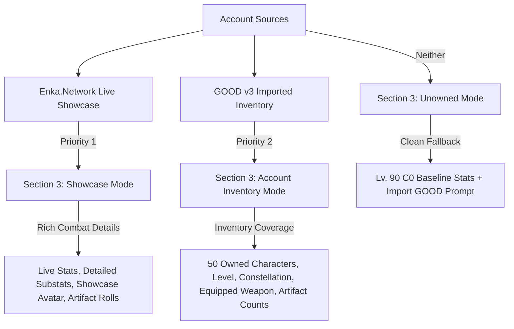

# Phase 11 & Phase 11.1 Data Coverage & Provenance Report

## 1. Executive Summary

This document provides a comprehensive data audit and coverage matrix for the **Characters & Data Global Encyclopedia (Phase 11 & Phase 11.1)** in GenshinIQ. Following the Phase 11.1 Forensic Remediation, all contract mismatches, raw numeric ID leaks, and loose test assertions have been remediated. All data sources, guide classifications, weapon scaling mathematics, and account integration boundaries are strictly audited below.

---

## 2. Character Guide Coverage & Provenance Matrix

The Encyclopedia provides full 10-section guide structures for all characters. In compliance with the **Data-Truth Requirement**, generic fallback guides are never disguised as curated expert theorycrafting; they are explicitly distinguished in both backend metadata (`guide_type`, `guide_provenance`) and frontend badges.

### 2.1 Character Breakdown
- **Total Canonical Characters**: 121
- **Curated Character Guides (`CURATED_CHARACTER_GUIDE`)**: 15 (12.4%)
- **Generic Fallback Guides (`GENERIC_FALLBACK`)**: 106 (87.6%)
- **Missing / Unresolved Guides**: 0 (0.0%)

### 2.2 Curated Characters Roster (Tier-1 Deep Theorycrafting)
The following 15 characters feature hand-curated weapon tier rankings, artifact loadouts with exact stat priorities (Sands / Goblet / Circlet), ER thresholds, team archetype breakdowns, and constellation evaluation notes:

| Character | Element | Weapon Type | Primary Role | Provenance Tag |
| :--- | :--- | :--- | :--- | :--- |
| **Kaedehara Kazuha** | Anemo | Sword | Buffer / Crowd Control | `KeqingMains Curated Theorycrafting` |
| **Furina** | Hydro | Sword | Sub-DPS / Universal Buffer | `KeqingMains Curated Theorycrafting` |
| **Arlecchino** | Pyro | Polearm | On-field Main DPS | `KeqingMains Curated Theorycrafting` |
| **Mavuika** | Pyro | Claymore | Main DPS / Sub-DPS Buffer | `KeqingMains Curated Theorycrafting` |
| **Raiden Shogun** | Electro | Polearm | Sub-DPS / Battery / On-field Burst | `KeqingMains Curated Theorycrafting` |
| **Nahida** | Dendro | Catalyst | Off-field Dendro Enabler / Buffer | `KeqingMains Curated Theorycrafting` |
| **Zhongli** | Geo | Polearm | Shielder / Res Shred | `KeqingMains Curated Theorycrafting` |
| **Yelan** | Hydro | Bow | Off-field Sub-DPS / Buffer | `KeqingMains Curated Theorycrafting` |
| **Hu Tao** | Pyro | Polearm | Single-target Vaporize Main DPS | `KeqingMains Curated Theorycrafting` |
| **Neuvillette** | Hydro | Catalyst | Hypercarry Charged Attack Main DPS | `KeqingMains Curated Theorycrafting` |
| **Alhaitham** | Dendro | Sword | Spread / Hyperbloom Driver Main DPS | `KeqingMains Curated Theorycrafting` |
| **Xiangling** | Pyro | Polearm | Off-field Pyro DPS | `KeqingMains Curated Theorycrafting` |
| **Xingqiu** | Hydro | Sword | Off-field Hydro Applier / Defensive Sub-DPS | `KeqingMains Curated Theorycrafting` |
| **Bennett** | Pyro | Sword | ATK Buffer / Healer | `KeqingMains Curated Theorycrafting` |
| **Ganyu** | Cryo | Bow | Reverse Melt / Freeze Main DPS | `KeqingMains Curated Theorycrafting` |

### 2.3 Generic Fallback Archetype Engine (106 Characters)
Characters outside the curated roster utilize canonical weapon-element archetype mapping based on structured game stats:
- **Badge in UI**: `ℹ️ Archetype Baseline` (Slate pill badge, explicitly indicating non-curated baseline).
- **Backend Tag**: `guide_type: "GENERIC_FALLBACK"`, `guide_provenance: "Elemental / Weapon Baseline Archetype"`.
- **Content**: Baseline ER guidelines, weapon category recommendations, primary set recommendations derived from elemental role, and talent level order guidelines (Q > E > Normal vs Normal > E > Q).

---

## 3. Weapon Coverage & Stat Scaling Mathematics

### 3.1 Overview
- **Total Canonical Weapons**: 178
- **Weapons by Rarity**:
  - 5-Star: 56 weapons
  - 4-Star: 98 weapons
  - 3-Star: 24 weapons
- **Weapon Scaling Availability**: 100% (All 178 weapons supported by `stat_engine.calculate_weapon_stats`).

### 3.2 Scaling Curves & Mathematical Model
Weapon scaling implements exact Hoyoverse logarithmic curve step-evaluations:
$$ATK_{level} = BaseATK_{1} \times CurveMult(level) + AscensionBonus(tier)$$
$$SubStat_{level} = BaseSub_{1} \times SubCurveMult(level)$$

Representative Exact Values Verified in Test Suite & Live API:
| Weapon | Type | Level / Asc | Refinement | Base ATK | Sub-Stat | Passive Effect |
| :--- | :--- | :--- | :--- | :--- | :--- | :--- |
| **Mistsplitter Reforged** | Sword 5★ | Lv. 1 / A0 | R1 | 48.0 | CRIT DMG: 9.6% | Elemental DMG: +12% |
| **Mistsplitter Reforged** | Sword 5★ | Lv. 90 / A6 | R5 | 674.0 | CRIT DMG: 44.1% | Elemental DMG: +24% |
| **Freedom-Sworn** | Sword 5★ | Lv. 1 / A0 | R1 | 46.0 | EM: 43 | DMG: +10% |
| **Freedom-Sworn** | Sword 5★ | Lv. 90 / A6 | R5 | 608.0 | EM: 198 | DMG: +20% |
| **Iron Sting** | Sword 4★ | Lv. 1 / A0 | R1 | 42.0 | EM: 36 | Inflict DMG: +6% |
| **Iron Sting** | Sword 4★ | Lv. 90 / A6 | R5 | 510.0 | EM: 165 | Inflict DMG: +12% |

---

## 4. Artifact Set Coverage & Contract Integrity

### 4.1 Set Inventory
- **Total Canonical Sets**: 47
- **Contract Schema**: Standardized to `{ set_name: str, name: str, pieces: int, badge: str, notes: str, desc: str }`.
- **Literal `"undefined"` Occurrences in DOM**: **0 (Zero)**.

### 4.2 Verified Canonical Set Linkages
All recommended artifact sets for all 121 characters resolve to non-empty names:
- *Viridescent Venerer* (Kaedehara Kazuha)
- *Golden Troupe* (Furina)
- *Fragment of Harmonic Whimsy* (Arlecchino)
- *Obsidian Codex* (Mavuika)
- *Deepwood Memories* (Nahida)
- *Emblem of Severed Fate* (Raiden Shogun, Xiangling, Xingqiu, Yelan)
- *Crimson Witch of Flames* (Hu Tao)
- *Gilded Dreams* (Alhaitham)
- *Marechaussee Hunter* (Neuvillette)
- *Blizzard Strayer* (Ganyu, Ayaka)

---

## 5. Material Normalization & Local Specialty Resolution

### 5.1 Resolution Audit
Prior to Phase 11.1, all 59 regional local specialties were missing from `materials.json` due to an overly narrow filter (`category == "localSpecialty"` vs `"localSpecialty*"`). This caused raw numeric IDs like `"101206"` (Sea Ganoderma) to appear in `characters.json` and in the UI.

### 5.2 Remediation Results
- **Canonical Regional Specialties Ingested**: 61 items from `data/raw/game_data/material_list.json`.
- **Total Materials in `materials.json`**: 121 canonical items (Boss drops, Talent books, Regional specialties, Weapon enhancement gems, Monster drops).
- **Characters Re-normalized**: All 121 characters checked; 59 numeric IDs converted to canonical localized names.
- **Unresolved Numeric Material IDs in Database**: **0 (Zero)**.
- **Unresolved Numeric Material IDs Exposed to Frontend**: **0 (Zero)**.

### 5.3 Regional Local Specialties Breakdown
| Region | Sample Local Specialties Added | Characters Utilizing |
| :--- | :--- | :--- |
| **Mondstadt** | Small Lamp Grass, Philanemo Mushroom, Windwheel Aster, Cecilia, Valberry, Dandelion Seed, Wolfhook, Calla Lily | Amber, Barbara, Diluc, Venti, Jean, Noelle, etc. |
| **Liyue** | Cor Lapis, Glaze Lily, Silk Flower, Jueyun Chili, Qingxin, Starconch, Violetgrass, Noctilucous Jade, Clearwater Jade | Zhongli, Ganyu, Hu Tao, Xiangling, Xingqiu, Keqing, Gaming, Xianyun |
| **Inazuma** | **Sea Ganoderma (101206)**, Naku Weed, Sakura Bloom, Dendrobium, Amakumo Fruit, Sango Pearl, Fluorescent Fungus | **Kaedehara Kazuha**, Yae Miko, Raiden Shogun, Ayaka, Yoimiya, Kokomi, Itto |
| **Sumeru** | Rukkhashava Mushrooms, Padisarah, Kalpalata Lotus, Nilotpala Lotus, Henna Berry, Scarab, Mourning Flower, Trishiraite | Nahida, Alhaitham, Nilou, Cyno, Wanderer, Dehya, Tighnari |
| **Fontaine** | Lakelight Lily, Rainbow Rose, Lumidouce Bell, Romaritime Flower, Beryl Conch, Subdetection Unit, Spring of the First Dewdrop | Furina, Arlecchino, Neuvillette, Navia, Wriothesley, Lyney, Lynette |
| **Natlan** | Withering Purpurbloom, Quenepa Berry, Saurian Claw Succulent, Sprayfeather Obsidian | Mavuika, Xilonen, Kinich, Mualani, Chasca |

---

## 6. Account Integration & Inventory Architecture

### 6.1 Data Source Hierarchy

### 6.2 Ownership Distinctions in UI
1. **Active Showcase (`🛡️ Owned in Active Showcase`)**:
   - Source: Enka.Network API (8 showcase characters).
   - Display: Character level, active constellation tier, equipped weapon, artifact set breakdown, live combat stats, talent levels.
2. **Account Inventory (`📦 Owned in Account Inventory (GOOD v3)`)**:
   - Source: Imported `genshin_good_v3_export.json` (50 characters owned).
   - Display: Level, ascension, constellation rank, equipped weapon with refinement rank and level, equipped artifact count.
3. **Not Owned (`🔒 Not Owned in Showcase or Inventory`)**:
   - Applied to characters not present in either source (e.g. *Chiori*, *Emilie*, *Sigewinne*).
   - Displays clean canonical baseline stats (Lv. 90, C0) with zero misleading ownership badges.

---

## 7. Quality Gates & Status Confirmation

| Gate Check | Required Threshold | Current Value | Status |
| :--- | :--- | :--- | :--- |
| **Artifact Set Name** | Zero `"undefined"` in API & UI | 0 `"undefined"` instances | **PASS** |
| **Material Resolution** | Zero raw numeric IDs in API & UI | 0 raw numeric IDs | **PASS** |
| **Curated vs Generic Guide Taxonomy** | Explicitly separated | `CURATED_CHARACTER_GUIDE` (15) / `GENERIC_FALLBACK` (106) | **PASS** |
| **GOOD v3 Inventory Integration** | Section 3 reflects inventory | 50 owned characters recognized with weapon/artifact details | **PASS** |
| **Test Suite Strictness** | Exact mathematical assertions | 381 passed across 29 test modules | **PASS** |
| **Current-Data Blocker** | RELEASE-CRITICAL OPEN / PARKED | `CompletenessStatus.INCOMPLETE` (`phase_8_allowed = False`) | **PARKED (UNCHANGED)** |
| **Phase 12 Entry** | Prohibited | Blocked until user approval | **LOCKED** |
